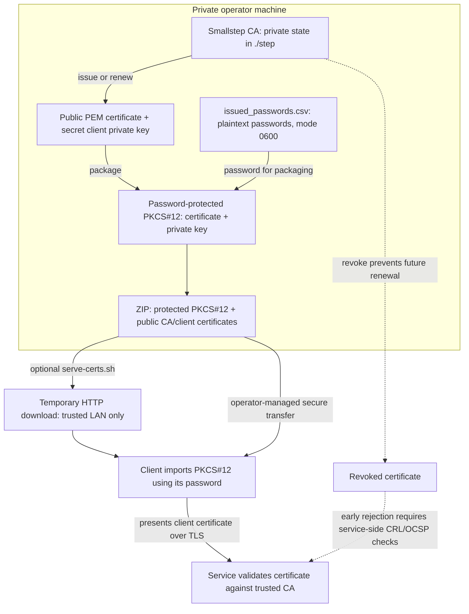

# mtls-cli

[](https://github.com/alsd4git/mtls-cli/actions/workflows/tests.yml)
[](https://github.com/alsd4git/mtls-cli/releases)
[](LICENSE)

Issue, renew, revoke, package, and share client certificates for mutual TLS.
The toolkit runs a pinned Smallstep CA with Docker Compose and uses the `step`
CLI for certificate operations.

## Quick start

Install the [requirements](#requirements), then start a local CA:

```bash
cp .env.example .env
# Set a strong STEP_CA_PASSWORD in .env
docker compose up -d
docker compose logs --follow step-ca
```

On the first run, initialization takes time. Wait for the logs to report that
the CA server is listening, then press Ctrl-C to stop following the logs.
The container keeps running. Issue a client certificate and inspect the inventory:

```bash
./issue-client-cert.sh laptop
./cert-manager.sh inventory
```

The issue command creates a certificate, private key, PKCS#12 bundle, and ZIP
under `certs_output/laptop/`. The ZIP contains private-key material inside the
password-protected PKCS#12 bundle. Only the separate raw PEM key file is excluded
unless you explicitly enable `INCLUDE_RAW_KEY_IN_ZIP=true`. Treat both the ZIP
and its password as sensitive.



In text: the local CA issues a public certificate and private client key.
`cert-manager.sh renew CLIENT_NAME` renews the certificate in place and rebuilds
the PKCS#12 and ZIP using the latest password in the local plaintext log.
The ZIP is not itself encrypted: its PKCS#12 is password-protected. Deliver the
bundle and password through trusted channels chosen by the operator; the scripts
do not arrange a separate secure password-delivery channel. Importing the bundle
does not configure a server: the relying service must trust the CA and enforce
client-certificate validation.

The optional HTTP download is temporary but not authenticated or encrypted.
It exposes the selected ZIP to anyone who can reach the listener while it runs.
Do not expose it to the Internet or use it to serve CA state, PEM private keys,
or the password log. See the [security model](#security-model) and the
[Nginx Proxy Manager integration guide](docs/nginx-proxy-manager.md).

Revocation is not an automatic disconnect mechanism. The default Compose deployment
does not configure active revocation checking or a CRL endpoint, and open-source
step-ca does not provide OCSP. Do not assume that revoking a certificate makes
an already issued certificate unusable at relying services before expiry.
See [Smallstep's production guidance](https://smallstep.com/docs/step-ca/certificate-authority-server-production/).

## Security model

This project manages private keys and passwords. Read these points before using
it:

- `./step` contains the CA state and keys. Back it up securely and never commit
  it.
- `issued_passwords.csv` stores PKCS#12 passwords in plaintext by design. The
  scripts restrict it to mode `0600`; anyone who can read it can unlock issued
  bundles.
- generated ZIP files contain the encrypted PKCS#12 bundle and public
  certificates. They are not encrypted themselves.
- the temporary HTTP server is suitable only for a trusted local network.
- the default deployment does not distribute active revocation status. Existing
  certificates can remain usable at relying services until expiry.

## Requirements

- Docker with Compose
- Bash on Linux or macOS
- `step`, OpenSSL, `zip`, and `unzip`
- optional: `qrencode` for terminal QR codes

`./init_cli.sh` installs the command-line dependencies on Debian-based Linux
systems. On macOS, install them with Homebrew:

```bash
brew install smallstep zip
```

The scripts use atomic directory locks supported by both Linux and macOS.
Windows is not a supported execution target.

## Start the certificate authority

```bash
git clone https://github.com/alsd4git/mtls-cli.git
cd mtls-cli
cp .env.example .env
```

Set a strong `STEP_CA_PASSWORD` in `.env`, then start the CA:

```bash
docker compose up -d
```

The default bind address is `127.0.0.1:9001`. Set
`STEP_CA_BIND_ADDRESS=0.0.0.0` only when another host must reach the CA and a
firewall protects the port.

## Issue a client certificate

```bash
./issue-client-cert.sh
```

For non-interactive use, pass the client name:

```bash
./issue-client-cert.sh alice
```

The script restricts client names to a path-safe character set and creates:

```text
certs_output/alice/
  alice.crt
  alice.key
  alice.p12
  alice-certs.zip
issued_passwords.csv
roots.pem
```

The raw private key remains local and is excluded from the ZIP by default. Set
`INCLUDE_RAW_KEY_IN_ZIP=true` only when a recipient requires it.

For a non-loopback `CA_URL`, set `CA_FINGERPRINT`. This pins the CA root during
bootstrap. Omitting the fingerprint is accepted only for the legacy loopback
setup and produces a warning.

## Manage certificates

List the local inventory:

```bash
./cert-manager.sh inventory
```

Renew a certificate and rebuild its bundle with the recorded password:

```bash
./cert-manager.sh renew alice
```

Revoke a certificate:

```bash
./cert-manager.sh revoke alice "device lost"
```

Renewal keeps timestamped backups of the previous certificate and restores them
if the operation fails.

## Share one bundle

```bash
./serve-certs.sh certs_output/alice/alice-certs.zip
```

The command serves only the selected file, prints a QR code when `qrencode` is
available, and stops after five minutes. Configure the lifetime with
`EXPIRE_MINUTES`, the port with `PORT`, and address detection with `SHARE_IP`.

On Android, extract the ZIP, open the `.p12` file, and enter the password from
`issued_passwords.csv`. Android places the certificate under its credential
storage settings.

## Configuration

The main overrides are `CA_URL`, `CA_FINGERPRINT`, `PROVISIONER`,
`CERT_DURATION`, `OUT_DIR`, `ROOT_CA`, and `PASSWORD_LOG`. See the scripts and
`.env.example` for their defaults.

## Validation

```bash
shellcheck ./*.sh ./lib/*.sh ./tests/*.sh
./tests/run.sh
STEP_CA_PASSWORD=test-only docker compose config --quiet
```

The tests use a fake `step` command and temporary OpenSSL certificates. They do
not contact a live CA.

## Documentation and releases

- [Certificate format recap](cert-recap.md)
- [Nginx Proxy Manager guide](docs/nginx-proxy-manager.md)
- [Changelog](CHANGELOG.md)
- [GitHub releases](https://github.com/alsd4git/mtls-cli/releases)

## License

MIT. See [LICENSE](LICENSE).
